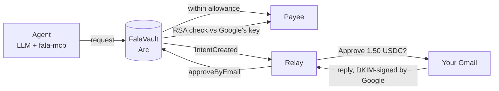

# Fala

**Your agent asks. You reply from Gmail. Arc checks Google's signature and pays.**

---

## Live on Arc mainnet

| | |
|---|---|
| **FalaVault** | [`0xE20D31af287e546A35897FD65a822f3dEF7FA008`](https://explorer.arc.io/address/0xE20D31af287e546A35897FD65a822f3dEF7FA008) |
| **Deploy tx** | [`0x19f32caa…ab72`](https://explorer.arc.io/tx/0x19f32caa0fb3c4f9f1b33e1546711afa5ad4d7392c34cdef3546fb2e5df7ab72) |
| **Chain** | Arc mainnet, 5042 · block 29095348 |
| **Cost to deploy** | 5,577,308 gas = **0.1116 USDC** |
| **DKIM key registered** | `gmail.com` selector `20260707` — **Google's real production key** |
| **Approver** | stored only as `keccak256`; the address itself is never on-chain |
| **Live app** | **https://fala-approve.vercel.app** |

Verify it yourself, no trust required:

```bash
V=0xE20D31af287e546A35897FD65a822f3dEF7FA008; R=https://rpc.mainnet.arc.io
cast call $V "approverHash()(bytes32)" --rpc-url $R   # 0xca56b56b…3d0c
cast keccak "fala.approver.1@gmail.com"               # the same value
cast call $V "getKeyIds()(bytes32[])" --rpc-url $R    # 0x15234f80…712b
dig +short TXT 20260707._domainkey.gmail.com          # Google's key, same modulus
```

A real Gmail reply has already released a real payment on Arc testnet:
[`0x8fbe3ea6…f3adb`](https://explorer.testnet.arc.io/tx/0x8fbe3ea6ed2ebd2e576711ac2efa8188b81d3fe588d86d3b06d2bc889e1f3adb)
— 2.00 USDC, verified against Google's own signature, 533,230 gas (≈0.011 USDC).
Full record in [docs/deployments.md](docs/deployments.md) and [docs/evidence.md](docs/evidence.md).

---

## The problem

Every tool builds its own front door. A dashboard to check, an app to install, an extension to approve in, a wallet to
sign with. Each one assumes you will come to it.

Now give an AI agent a budget. You have two options, and both are bad:

- **Give it a card.** It spends without asking. You find out afterwards.
- **Put a human in front of a wallet.** Every purchase needs someone to open an app, read a hex string and sign. The
  agent's speed is gone.

So most teams let agents do everything *except* spend money. The blocker is not capability. It is **consent** — there is
no way for a human to say "yes, that one" that is both fast and safe.

Meanwhile one interface was never fragmented. Around **4.6 billion people** use email, sending roughly **376 billion
messages a day** ([Radicati, via Statista](https://www.statista.com/statistics/255080/number-of-email-users-worldwide/)).
Nobody needs onboarding to reply to an email. And agents already live there — the invoices, quotes and confirmations
they act on arrive in the inbox.

Fala uses that inbox as the approval channel, and makes the reply cryptographically binding.

## How it works

An agent gets a vault with a small automatic allowance. Under the limit it just pays. Over the limit, it has to ask —
and asking means an email to you.



1. The agent calls `request(payee, amount, memo)`. Within its allowance and to a known payee, it is paid instantly (`AutoPaid`).
2. Otherwise the vault stores an **intent** with a binding code and emits `IntentCreated`. The relay emails you.
3. The email's buttons open a reply with the subject already filled in: `FALA APPROVE 42 7f3a9c1b`. You press Send.
4. **Gmail DKIM-signs your reply on the way out.** The relay verifies that signature locally, dry-runs `checkEmail` so no
   gas is wasted on junk, then submits `approveByEmail`.
5. The contract recomputes `sha256(headerBlock)`, verifies Google's RSA signature against the registered key, requires
   `From == approver`, `From domain == d=`, the subject code to match this exact intent, and a fresh signing time — then pays.

**What is trusted:** only header lines inside the block Google signed. Never the body. Never anything the relay adds.
The relay cannot change the payee or the amount — both come from the intent already stored on-chain.

### Why the reply cannot be faked

A prompt-injected agent can write any email it wants. **It cannot make Google sign one from you.**

That is the whole security argument. The signature is produced by Google's DKIM private key, at send time, over your
headers. The contract holds Google's public key and does the RSA-2048 check itself, inside the transaction.

> *zk-email without the zk.* No circuits, no prover, no trusted setup — a direct modexp verification that costs about a cent.

### Subject grammar (strict)

```
FALA <APPROVE|DENY> <intentId> <code>      code = 8 lowercase hex = first 4 bytes of the intent code
FALA FREEZE 0 <code>                       code = keccak256(chainid, vault, "FREEZE") — bound to one vault
```

An optional `re: ` prefix and surrounding spaces are tolerated; anything else is `SubjectMalformed`. The code binds an
email to one exact request, so an approval cannot be replayed for another amount, payee, vault or chain.

## The refusal room

Failed verification **reverts with a named error**, and each one is a test. These are the attacks the contract refuses:

| Error | Meaning |
|---|---|
| `BadSignature` | headers changed after Google signed them, or signed by another key |
| `FromNotApprover` | genuine Gmail signature, but not from the approver |
| `DomainMismatch` | From domain differs from the signing domain |
| `CodeMismatch` | subject code belongs to a different request |
| `IntentNotPending` | already approved / denied / expired — replay refused |
| `StaleTimestamp` | signed before the request existed, after it expired, or older than the last freeze |
| `SubjectMalformed` | not exactly `FALA … <id> <code>` |
| `DuplicateHeader` / `MissingHeader` / `DkimNotLast` / `HeaderNotSigned` | header-injection and coverage tricks |
| `WrongAlgorithm` / `WrongCanonicalization` / `MalformedHeader` / `BadFrom` | not the one form Fala checks |
| `UnknownKey` / `KeyRevoked` / `KeyNotActive` | key registry — timelocked additions, instant revocation |
| `Frozen` / `IntentExpired` / `UseDeposit` | vault state |

Plain-language text for each lives in `src/lib/refusals.ts`.

## Why Arc

- **USDC is the gas token.** The thing you approve and the thing that pays the fee are the same unit. No second token to
  hold, no swap between approving and paying.
- **RSA-2048 on the modexp precompile.** An approval costs 533,230 gas ≈ **0.011 USDC**, measured on-chain with real Gmail
  mail. That is what makes direct verification viable where a ZK circuit would otherwise be required.
- **Deployment is cheap enough to give every user their own contract.** A vault costs 0.11 USDC to deploy, so isolation is
  the default rather than a premium feature.
- **Fast finality** lets the "Payment sent" receipt land in the same thread while the person is still reading.

## How Arc Studio was used

The contracts were written locally, then taken through Arc Studio for review and deployment
([project `7b5f36e6`](https://studio.arc.io/app/7b5f36e6-a2d1-4ccc-b925-f3cf4a4bd39b)). Three runs, recorded in
[docs/studio-runs/](docs/studio-runs/) with the exact prompts in [prompts/](prompts/):

1. **Review and harden.** Studio ran `forge test` plus a Slither and manual security review focused on header parsing,
   replay, code binding, the key registry timelock, reentrancy and payout failure. It fixed real findings and **added 22
   regression tests**, taking the suite from 41 to 63 passing. Findings are written up in
   [SECURITY_REVIEW.md](SECURITY_REVIEW.md).
2. **Deploy to testnet.** Studio rebuilt, reran the suite, and deployed with the owner passed explicitly as a constructor
   argument rather than defaulting to the deployer.
3. **Verify.** Studio confirmed `owner()` and that `approverHash` equalled `keccak256` of the lowercased approver address,
   and reported the exact strings `subjectFor` returns so the email templates could not drift from the contract.

One detail worth keeping: in run 2 Studio **refused to deploy**. The platform masked the approver address in what it
could see, so it received the literal text `[REDACTED_EMAIL]`, and it would not guess — the address is hashed into the
contract at construction and cannot be edited afterwards without an owner transaction. It asked rather than assumed. The
mainnet deployment in this README was then done directly with Foundry against the same reviewed contract.

## Project layout

```
contracts/   DkimVerifier + FalaVault (Foundry, 64 tests)
src/         Next.js app — vaults, agents, requests, payees, activity
server/      API + mail relay (Hono, SQLite), deployed on Fly
worker/      Cloudflare Email Worker variant of the relay, with its own tests
agent/       Groq agent, fala-mcp MCP server, test tools
docs/        deployments.md · evidence.md · DEMO_PITCH_PLAN.md
```

**Deployed shape:** the Next.js app runs on Vercel; the API and relay run on Fly with SQLite on a volume. The machine
sleeps when idle and a scheduled job wakes it every five minutes to sweep the inbox, so the whole thing runs inside free
tiers. The relay reads one shared Gmail inbox over IMAP, matches each reply to the vault whose approver sent it, verifies
and submits it, then mails the receipt.

## Status

- ✅ **Arc mainnet:** FalaVault deployed with Google's real DKIM key, verified on-chain (above).
- ✅ **Real Gmail, real money:** a reply from a real Gmail account released 2.00 USDC on testnet.
- ✅ 64 contract tests including fuzz, reentrancy and a real-Gmail fixture; 17 relay tests.
- ✅ DKIM canonicalizer cross-checked against the independent `mailauth` implementation.
- ✅ Live app, API and mail relay deployed.
- ⏳ The mainnet vault is deployed but the hosted app still points at testnet — see *Honest limits*.

## Run it

```bash
# contracts
cd contracts && npm install && forge install foundry-rs/forge-std --no-git
forge test -vv            # ffi is enabled in foundry.toml (a Node script signs the synthetic emails)

# app
npm install && cp .env.example .env.local
npx vitest run && npm run dev

# server (API + relay)
cd server && npm install && cp .env.example .env && npm start

# agent (Groq) and MCP
cd agent && npm install && cp .env.example .env
npm run e2e
claude mcp add fala -- npx tsx $PWD/src/mcp-server.ts
```

After changing the contract: `forge build && node scripts/gen-abi.mjs`. After touching `src/lib/dkim.ts` or
`refusals.ts`: `node scripts/sync-dkim.mjs` (the worker keeps identical copies; `--check` fails on drift).

## Honest limits

- **The hosted app is still on testnet.** The mainnet contract is live, but switching the platform over needs a spending
  cap first: vault deployment and agent funding are currently paid by a platform wallet with no per-user limit.
- **Privacy:** the approval transaction carries the email headers (From, To, Subject, Date) in calldata, readable by
  anyone. Use a **dedicated Gmail**. The message body is never sent on-chain.
- **Gmail only:** the From domain must equal the DKIM `d=`, which limits approvers to Gmail addresses.
- **Key rotation:** Google rotates DKIM keys. New keys go through a timelock; old keys can be revoked instantly. If
  Google rotates before a new key is added, approvals **fail closed** rather than open.
- **Trust in Google:** whoever controls Google's DKIM private key can sign approvals.
- **Account takeover:** if someone owns your Gmail they can approve. The hard cap bounds the damage per request; FREEZE
  works from any device you still control; only the owner wallet can unfreeze or withdraw.
- **Owner key** is still powerful (withdraw, change approver). Roadmap: passkey or hardware owner.
- **Not audited.** Small amounts only.

## Prior art, honestly

Proving emails on-chain exists — [zk-email](https://zk.email) does it with zero-knowledge proofs. Fala's difference is
**direct RSA verification**: no circuits, no prover, about a cent on Arc, used specifically as a *human approval key for
agent payments*. It applies MergePay's idea — verify a Web2 RSA signature on-chain because Arc makes it cheap — to the
most universal signer there is.

## Roadmap

Outlook and Google Workspace keys, 2-of-3 approvers, approval ceilings in the subject (`APPROVE UP TO 5`), Telegram and
Slack approval channels, an SDK for agent frameworks, a passkey owner.
