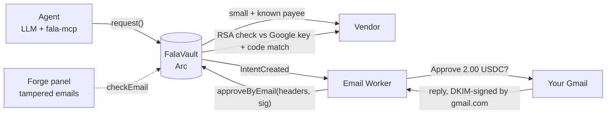

# Fala

**Your agent asks. You reply from Gmail. Arc checks Google's signature and pays.**

An AI agent spends small amounts on its own. For anything bigger it emails you. You tap **Approve** in the email and hit send.
The Arc contract verifies Gmail's own **DKIM signature** on your reply — onchain, no zero-knowledge proof, under a cent — and only
then releases the USDC. Your inbox is the second key: no wallet app, no seed phrase, no dashboard needed for the human.

> *zk-email without the zk.* &nbsp;·&nbsp; *A prompt-injected agent can write any email it wants. It can't make Google sign one from you.*

```
contracts/   DkimVerifier + FalaVault (Foundry)
src/         React dashboard + shared src/lib/dkim.ts canonicalizer
worker/      Cloudflare Email Worker: sends the approval email, relays your reply onchain
agent/       Groq agent, fala-mcp MCP server, test tools
docs/        evidence.md · spike.md · deployments.md
```

## How it works



1. The agent calls `request(payee, amount, memo)`. Within its allowance and to a known payee, it is paid instantly (`AutoPaid`).
2. Otherwise the vault stores an **intent** with a binding code and emits `IntentCreated`. The Worker emails you three buttons.
3. A button opens a reply with the exact subject filled in: `FALA APPROVE 42 7f3a9c1b`. You press Send; Gmail DKIM-signs it.
4. The Worker verifies the signature locally (no gas wasted on junk), dry-runs `checkEmail`, then submits `approveByEmail`.
5. The contract recomputes `sha256(headerBlock)`, verifies Gmail's RSA signature against the registered key, requires
   `From == approver`, `From domain == d=`, the subject code to match this exact intent, and a fresh signing time — then pays.

**What is trusted:** only header lines inside the signed block (Google signed them). Never the body, never anything the relayer adds.
The relayer cannot change anything: payee and amount come from the intent stored onchain.

### Subject grammar (strict)

```
FALA <APPROVE|DENY> <intentId> <code>      code = 8 lowercase hex = first 4 bytes of
FALA FREEZE 0 0                            keccak256(chainid, vault, id, agent, payee, amount)
```
An optional `re: ` prefix and surrounding spaces are tolerated; anything else is `SubjectMalformed`. The code binds an email to
one exact request, so an approval can't be reused for another amount, payee, vault or chain.

## The refusal room

Failed verification **reverts with a named error**. The dashboard's *Try to forge an approval* panel runs 11 attacker emails as free
`eth_call`s against the live vault (`public/forge/cases.json`), each refused by name:

| Error | Meaning |
|---|---|
| `BadSignature` | headers changed after Google signed them, or signed by another key |
| `FromNotApprover` | genuine Gmail signature, but not from the approver |
| `DomainMismatch` | From domain differs from the signing domain |
| `CodeMismatch` | subject code belongs to a different request |
| `IntentNotPending` | already approved / denied / expired — replay refused |
| `StaleTimestamp` | signed before the request existed, after it expired, or older than the last freeze |
| `SubjectMalformed` | not exactly `FALA … <id> <code>` |
| `DuplicateHeader` / `MissingHeader` / `DkimNotLast` / `HeaderNotSigned` | header-injection and coverage tricks |
| `WrongAlgorithm` / `WrongCanonicalization` / `MalformedHeader` / `BadFrom` | not the one form Fala checks |
| `UnknownKey` / `KeyRevoked` / `KeyNotActive` | key registry (timelocked additions, instant revocation) |
| `Frozen` / `IntentExpired` / `UseDeposit` | vault state |

Plain-language text for each lives in `src/lib/refusals.ts`.

## Why Arc

RSA-2048 verification runs on Arc's modexp precompile: an approval is **≈ 450k gas ≈ 0.0095 USDC** (measured on testnet, see
[docs/evidence.md](docs/evidence.md)). The relayer is tipped in the same asset it pays gas in (USDC), and sub-second finality
lets the "Paid ✅" email go out right after the receipt.

## Honest prior art

Proving emails onchain exists (zk-email, using zero-knowledge proofs). Fala's difference: **direct RSA verification** — no circuits,
no prover, about a cent on Arc — used as a human approval key for agent payments. This applies MergePay's idea (verify a Web2 RSA
signature onchain because Arc makes it cheap) to the most universal signer there is: email.

## Status — what is proven, what is not

- ✅ Contracts: 41 tests pass (T1–T33 incl. fuzz), refusal cases for every named error.
- ✅ Arc testnet: full flow with a **stand-in Gmail key** — see [docs/evidence.md](docs/evidence.md).
- ✅ DKIM canonicalizer cross-checked against the independent `mailauth` implementation.
- ⏳ **Real Gmail signature on Arc** — needs one real `.eml` ([docs/spike.md](docs/spike.md)). Until then the testnet vault trusts a key I control, not Google's.
- ⏳ Cloudflare Worker is written and unit-tested but not yet deployed (needs a domain + Email Routing).
- ⏳ Mainnet deployment.
- ⏳ Arc Studio: contracts and app were built locally with Foundry, not through Studio runs.

## Run it

```bash
# contracts
cd contracts && npm install && forge install foundry-rs/forge-std --no-git
forge test -vv            # ffi is enabled in foundry.toml (a Node script signs the synthetic emails)

# dashboard (+ canonicalizer tests)
npm install && cp .env.example .env
npx vitest run && npm run dev

# agent (Groq) and MCP
cd agent && npm install && cp .env.example .env
npm run e2e               # configure, fund, auto-pay, queue, approve with a stand-in Gmail signature
npm run agent             # Groq procurement agent
claude mcp add fala -- npx tsx $PWD/src/mcp-server.ts

# worker
cd worker && npm install && npx wrangler login && npx wrangler deploy
```
After changing the contract: `forge build && node scripts/gen-abi.mjs`. After touching `src/lib/dkim.ts` or `refusals.ts`:
`node scripts/sync-dkim.mjs` (the Worker keeps identical copies; `--check` fails on drift).

## Honest limits

- **Privacy:** the approval transaction carries the email headers (From, To, Subject, Date) in calldata, readable by anyone. Use a
  **dedicated Gmail**. The message body is never sent onchain.
- **Gmail aliases:** the From domain must equal the DKIM `d=` (gmail.com), which limits approvers to Gmail addresses.
- **Key rotation:** Gmail rotates DKIM keys occasionally. New keys go through a timelock; old keys can be revoked instantly. If Google
  rotates, approvals fail closed until the new key is added.
- **Trust in Google:** whoever controls Google's DKIM private key can sign approvals. Same trust model as trusting GitHub in MergePay.
- **Account takeover:** if someone owns your Gmail they can approve. The hard cap bounds the damage per request; FREEZE works from any
  device you still control; only the owner wallet can unfreeze or withdraw.
- **Owner key** is still powerful (withdraw, change approver). Roadmap: passkey/hardware owner.
- Not audited. Small amounts only.

## Roadmap

Outlook / Google Workspace keys, 2-of-3 approvers, approval ceilings in the subject (`APPROVE UP TO 5`), Telegram/Slack approval
channels, an SDK for agent frameworks, a passkey owner.
